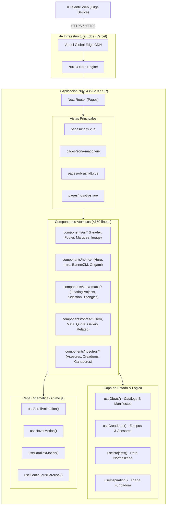

<div align="center">

  <a href="https://umbral-web-three.vercel.app/" target="_blank">
    
  </a>

  <br /><br />

  <h1>🏛️ UMBRAL · CENTRO ROBERTO GARZA SADA</h1>

  <blockquote>
    <strong>Plataforma Oficial de Exhibición Digital & Arquitectura Contemporánea</strong><br />
    Escuela de Arte, Arquitectura y Diseño · Universidad de Monterrey (UDEM) · ZⓈONAMACO 2027
  </blockquote>

  <p>
    <a href="https://umbral-web-three.vercel.app/" target="_blank">
      
    </a>
  </p>

  <!-- Badges Grid -->
  <p>
    <a href="https://nuxt.com/"></a>
    <a href="https://vuejs.org/"></a>
    <a href="https://bun.sh/"></a>
    <a href="https://tailwindcss.com/"></a>
    <a href="https://www.typescriptlang.org/"></a>
    <a href="https://animejs.com/"></a>
  </p>
  <p>
    
    
    
    
  </p>

  <!-- Lighthouse Audit Table -->
  <br />
  <table>
    <thead>
      <tr>
        <th align="center">⚡ Performance</th>
        <th align="center">♿ Accessibility</th>
        <th align="center">🛡️ Best Practices</th>
        <th align="center">🔍 SEO</th>
      </tr>
    </thead>
    <tbody>
      <tr>
        <td align="center"></td>
        <td align="center"></td>
        <td align="center"></td>
        <td align="center"></td>
      </tr>
    </tbody>
  </table>

</div>

---

## 📑 Tabla de Contenidos

- [🏛️ Visión & Filosofía Tectónica](#-visión--filosofía-tectónica)
- [✨ Bento Box de Características](#-bento-box-de-características)
- [🎨 Las 10 Obras Seleccionadas (ZⓈONAMACO 2027)](#-las-10-obras-seleccionadas-zsonamaco-2027)
- [🖼️ Galería Visual & Showcase](#️-galería-visual--showcase)
- [🏗️ Arquitectura Técnica del Sistema](#️-arquitectura-técnica-del-sistema)
- [📂 Estructura de Directorios](#-estructura-de-directorios)
- [🎬 Motor de Movimiento & Animación Cinemática](#-motor-de-movimiento--animación-cinemática)
- [🚀 Quick Start & Developer Experience (Bun Only)](#-quick-start--developer-experience-bun-only)
- [🧪 Control de Calidad & QA Sniper Suite](#-control-de-calidad--qa-sniper-suite)
- [🗺️ Roadmap & Estado de Entrega](#️-roadmap--estado-de-entrega)
- [🧠 Conexión Zettelkasten & Segundo Cerebro](#-conexión-zettelkasten--segundo-cerebro)
- [👥 Créditos, Equipo e Instituciones](#-créditos-equipo-e-instituciones)

---

## 🏛️ Visión & Filosofía Tectónica

**UMBRAL** es la plataforma digital de exhibición curatorial del **Centro Roberto Garza Sada de Arte, Arquitectura y Diseño (CRGS)** de la **Universidad de Monterrey (UDEM)**. Diseñado por el arquitecto galardonado con el Premio Pritzker **Tadao Ando**, el edificio —conocido como *"La Puerta de la Creación"*— es un hito de concreto aparente postensado con un vano escultórico de 70 metros de claro libre.

Esta plataforma fue concebida no como un sitio web corporativo convencional, sino como una **extensión escultórica digital** del CRGS de cara a su participación en **ZⓈONAMACO 2027**, la feria de arte contemporáneo más influyente de América Latina.

```
                    ┌───────────────────────────────────────────────┐
                    │      LA PUERTA DE LA CREACIÓN (CRGS)          │
                    │         Vano Tectónico de 70 Metros           │
                    └───────────────────────┬───────────────────────┘
                                            │
               ┌────────────────────────────┴────────────────────────────┐
               ▼                                                         ▼
    ┌─────────────────────────────┐                           ┌─────────────────────────────┐
    │    REPRESENTACIÓN DIGITAL   │                           │     EXHIBICIÓN CURATORIAL   │
    │   Fidelidad 1:1 con Figma   │                           │       ZⓈONAMACO 2027        │
    │   Tipografía Monumental     │                           │      10 Obras Escultóricas  │
    │   Composición en Origami    │                           │      Equipos de la Repentina│
    └─────────────────────────────┘                           └─────────────────────────────┘
```

### Principios Fundamentales de Diseño
1. **Rigor Geométrico Brutalista:** Diálogo entre el concreto gris crudo (`#070707`, `#1C1C1C`), el origami esmeralda del CRGS (`#4BA550`) y acentos de color curatorial.
2. **Ritmo Tipográfico Editorial:** Jerarquías contundentes con **Barlow Condensed** en titulares de gran formato y **Space Grotesk** en metadatos curatoriales y micro-lecturas.
3. **Cero Slop & Arquitectura Limpia:** Separación radical de responsabilidades. Ningún componente supera las 150-200 líneas; el estado curatorial reside en composables reactivos reutilizables y la animación cinemática opera fuera del thread principal.

---

## ✨ Bento Box de Características

<table>
  <tr>
    <td width="50%" valign="top">
      <h3>🏛️ Arquitectura Tadao Ando</h3>
      <p>Representación digital de <em>La Puerta de la Creación</em> con facetas de origami, cortes monumentales, coordenadas geográficas y homenaje a <strong>Doña Margarita Garza Sada</strong>, <strong>Don Roberto Garza Sada</strong> y <strong>Tadao Ando</strong>.</p>
    </td>
    <td width="50%" valign="top">
      <h3>🎨 Curaduría ZⓈONAMACO 2027</h3>
      <p>Catálogo inmersivo de las <strong>10 obras escultóricas</strong> seleccionadas de la Repentina multidisciplinaria, con fichas técnicas completas, manifiestos conceptuales y stands espaciales.</p>
    </td>
  </tr>
  <tr>
    <td width="50%" valign="top">
      <h3>⚡ Nuxt 4 & Server-Side Rendering</h3>
      <p>Construido sobre <strong>Nuxt 4</strong> con Vue 3 Composition API, enrutamiento dinámico de obras (<code>/obras/[id]</code>), reglas de redirección 301 (<code>/crgs -> /nosotros</code>) y cero saltos de hidratación.</p>
    </td>
    <td width="50%" valign="top">
      <h3>🎬 Motion Engine con Anime.js v4</h3>
      <p>Sistema de composables dedicados (<code>useScrollAnimation</code>, <code>useHoverMotion</code>, <code>useParallaxMotion</code>, <code>useContinuousCarousel</code>) orquestando entradas escalonadas y efectos de origami interactivo.</p>
    </td>
  </tr>
  <tr>
    <td width="50%" valign="top">
      <h3>👥 Ecosistema de Creadores & Docentes</h3>
      <p>Matriz dinámica que mapea los 10 equipos de estudiantes, sus directores de proyecto, líderes de diseño y la plantilla docente de las 5 carreras oficiales: <strong>LINT</strong>, <strong>LDM</strong>, <strong>LDI</strong>, <strong>LDG</strong> y <strong>LAED</strong>.</p>
    </td>
    <td width="50%" valign="top">
      <h3>🧪 Test Suite Sniper (100% Green)</h3>
      <p>Batería de <strong>39 tests automatizados</strong> con <code>bun test</code> ejecutados en ~400ms, verificando integridad de navegación, carruseles continuos, precisión de datos de Figma y estabilidad de componentes UI.</p>
    </td>
  </tr>
</table>

---

## 🎨 Las 10 Obras Seleccionadas (ZⓈONAMACO 2027)

Las piezas seleccionadas representan la vanguardia del diseño mexicano multidisciplinario:

| # | Obra | Concepto Curatorial | Disciplinas Integradas | Ficha Técnica |
|---|------|---------------------|------------------------|---------------|
| **01** | **Encuadre** | Ventana tectónica que enmarca la perspectiva espacial y la luz. | Arquitectura · Diseño Gráfico | [`/obras/encuadre`](https://umbral-web-three.vercel.app/obras/encuadre) |
| **02** | **Cimiento** | Bloque monolítico de raigambre industrial y origen matérico. | Diseño Industrial · Interiores | [`/obras/cimiento`](https://umbral-web-three.vercel.app/obras/cimiento) |
| **03** | **Curado** | Proceso de maduración del concreto expuesto y el paso del tiempo. | Arte · Diseño Industrial | [`/obras/curado`](https://umbral-web-three.vercel.app/obras/curado) |
| **04** | **Norte Rey** | Homenaje a la fuerza manufacturera y la identidad regiomontana. | Diseño Gráfico · Textil | [`/obras/norte-rey`](https://umbral-web-three.vercel.app/obras/norte-rey) |
| **05** | **Entretiempo** | Pausa cinemática entre el vacío y la masa estructural. | Arquitectura · Moda | [`/obras/entretiempo`](https://umbral-web-three.vercel.app/obras/entretiempo) |
| **06** | **Interconexión** | Sistema modular de tensores que desafían el centro de gravedad. | Diseño Industrial · Digital | [`/obras/interconexion`](https://umbral-web-three.vercel.app/obras/interconexion) |
| **07** | **Mai** | Silueta biomórfica de integración botánica y sustentabilidad. | Interiores · Arte | [`/obras/mai`](https://umbral-web-three.vercel.app/obras/mai) |
| **08** | **Reliquia** | Arqueología del futuro inscrita en piedra caliza y acero pulido. | Arte · Arquitectura | [`/obras/reliquia`](https://umbral-web-three.vercel.app/obras/reliquia) |
| **09** | **Roberto** | Diálogo mobiliario inspirado en la filantropía y el mecenazgo cultural. | Diseño Industrial · Madera | [`/obras/roberto`](https://umbral-web-three.vercel.app/obras/roberto) |
| **10** | **Sagaon** | Torsión plástica y experimentación volumétrica de alto contraste. | Diseño Gráfico · Escultura | [`/obras/sagaon`](https://umbral-web-three.vercel.app/obras/sagaon) |

---

## 🖼️ Galería Visual & Showcase

<div align="center">
  <table>
    <tr>
      <td width="50%" align="center">
        <strong>Home · Hero Monolítico & Puerta de la Creación</strong><br /><br />
        
      </td>
      <td width="50%" align="center">
        <strong>ZⓈONAMACO · Catálogo Espacial 1:1 Figma</strong><br /><br />
        
      </td>
    </tr>
    <tr>
      <td width="50%" align="center">
        <strong>Ficha Técnica de Obras · Split Curatorial</strong><br /><br />
        
      </td>
      <td width="50%" align="center">
        <strong>Nosotros / CRGS · Oferta Académica & Comunidad</strong><br /><br />
        
      </td>
    </tr>
  </table>
</div>

---

## 🏗️ Arquitectura Técnica del Sistema

El sistema implementa una arquitectura desacoplada y orientada a la experiencia de usuario (UX Pro Max):



---

## 📂 Estructura de Directorios

<details>
<summary><strong>🔍 Click para desplegar el árbol de archivos del proyecto</strong></summary>

```
umbral-web/
├── app.vue                         # Layout raíz con transiciones de página
├── nuxt.config.ts                  # Configuración Nuxt 4, SEO Meta, Tailwind & Polyfills
├── tailwind.config.ts              # Tokens de diseño, tipografía Barlow & Space Grotesk
├── tsconfig.json                   # Tipado estricto TypeScript
├── package.json                    # Dependencias y scripts
├── bun.lock                        # Lockfile canónico de Bun
│
├── assets/
│   └── css/
│       └── main.css                # Directivas Tailwind, tipografías y scrollbar
│
├── components/                     # Componentes modulares (< 150 líneas)
│   ├── crgs/                       # Secciones del Centro Roberto Garza Sada
│   │   ├── CrgsHero.vue
│   │   ├── CrgsPuertaCreacion.vue
│   │   ├── CrgsPrograms.vue
│   │   └── CrgsInformacionAcademica.vue
│   ├── home/                       # Landing Page / Home
│   │   ├── HomeHero.vue
│   │   ├── HomeIntro.vue
│   │   ├── HomeBannerZM.vue
│   │   ├── HomeCrgs.vue
│   │   ├── HomeInspiration.vue
│   │   ├── ArchitecturalOrigami.vue
│   │   └── InspirationCarousel.vue
│   ├── nosotros/                   # Manifiesto, Creadores y Asesores
│   │   ├── NosotrosHero.vue
│   │   ├── NosotrosAsesores.vue
│   │   ├── NosotrosCreadorCard.vue
│   │   ├── NosotrosGanadoresRepentina.vue
│   │   └── NosotrosInfiniteCarousel.vue
│   ├── obras/                      # Fichas técnicas de piezas escultóricas
│   │   ├── ObraHero.vue
│   │   ├── ObraMeta.vue
│   │   ├── ObraQuote.vue
│   │   ├── ObraGallery.vue
│   │   └── ObraRelated.vue
│   ├── ui/                         # Primitivas globales y shell
│   │   ├── AppHeader.vue
│   │   ├── AppFooter.vue
│   │   ├── AppImage.vue
│   │   ├── AppMarquee.vue
│   │   └── ArchitecturalBlueprintFrame.vue
│   └── zona-maco/                  # Exhibición y selección ZⓈONAMACO
│       ├── ZonaMacoHero.vue
│       ├── ZonaMacoFloatingProjects.vue
│       ├── ZonaMacoSelection.vue
│       └── ZonaMacoIntegrantesBanner.vue
│
├── composables/                    # Lógica desacoplada y estado reactivo
│   ├── useObras.ts                 # Catálogo oficial de obras, textos y manifiestos
│   ├── useCreadores.ts              # Estudiantes, asignación de equipos y fotos
│   ├── useProjects.ts              # Relaciones y metadatos de proyectos
│   ├── useAdvisors.ts              # Claustro docente y líderes de proyecto
│   ├── useCareers.ts               # Programas profesionales de UDEM
│   ├── useInspiration.ts           # Margarita, Roberto y Tadao Ando
│   ├── useScrollAnimation.ts       # IntersectionObserver con Anime.js
│   ├── useHoverMotion.ts           # Interacciones fluidas al hover
│   ├── useParallaxMotion.ts        # Cálculo de scroll y profundidad
│   └── useContinuousCarousel.ts    # Carruseles infinitos sin tirones
│
├── pages/                          # Enrutamiento basado en archivos
│   ├── index.vue                   # Home institucional
│   ├── nosotros.vue                # Manifiesto y creadores
│   ├── zona-maco.vue               # Exhibición ZⓈONAMACO
│   ├── integrantes.vue             # Directorio de integrantes
│   ├── crgs.vue                    # Redirección oficial a /nosotros
│   └── obras/
│       └── [id].vue                # Ficha técnica dinámica de la obra
│
├── public/                         # Assets estáticos servidos en raíz
│   ├── images/                     # Fotografías del CRGS, obras y vectores SVG
│   ├── favicon.svg                 # Favicon vectorial
│   └── og-image.jpg                # OpenGraph Card para redes sociales
│
└── tests/                          # Suite de tests con Bun
    ├── app-header-navigation.test.ts
    ├── app-marquee.test.ts
    ├── creadores-piezas-figma.test.ts
    ├── hero-umbral-figma.test.ts
    ├── home-intro-figma.test.ts
    ├── motion-composables.test.ts
    ├── stands-asesores-figma.test.ts
    └── zona-maco-figma.test.ts
```
</details>

---

## 🎬 Motor de Movimiento & Animación Cinemática

La interactividad de UMBRAL se aleja de transiciones CSS convencionales mediante un pipeline cinemático sustentado en **Anime.js v4**:

1. **`useScrollAnimation`:** Observador reactivo de intersección que calcula visibilidad y desencadena timelines de Anime.js con interpolaciones elásticas (`cubicBezier(0.16, 1, 0.3, 1)`).
2. **`useContinuousCarousel`:** Motor inercial basado en `requestAnimationFrame` que mantiene movimiento perenne de 35s en el marquee y carruseles de inspiración, pausándose orgánicamente en hover sin saltos bruscos.
3. **`useHoverMotion` & `useParallaxMotion`:** Micro-interacciones matemáticas en tarjetas de obras y fotografías que simulan la volumetría del concreto de Tadao Ando según la posición del cursor.

---

## 🚀 Quick Start & Developer Experience (Bun Only)

> ⚠️ **Regla Estricta del Repositorio:** Este proyecto utiliza exclusivamente **Bun**. El uso de `npm` o `yarn` está prohibido. Si encuentras un archivo `package-lock.json`, elimínalo de inmediato.

### 1. Clonar el Repositorio
```bash
git clone https://github.com/juankio/umbral-web.git
cd umbral-web
```

### 2. Instalar Dependencias
```bash
bun install
```

### 3. Iniciar Servidor de Desarrollo
```bash
bun run dev
```
La aplicación estará disponible de inmediato en `http://localhost:3000`.

### 4. Ejecutar la Suite de Pruebas
```bash
bun test
```

### 5. Compilar para Producción
```bash
bun run build
```

### 6. Vista Previa Local del Build de Producción
```bash
bun run preview
```

---

## 🧪 Control de Calidad & QA Sniper Suite

El proyecto cuenta con un sistema de verificación visual y unitaria denominado **QA Sniper**:

```bash
$ bun test
bun test v1.3.7 (ba426210)

 ✓ tests/app-header-navigation.test.ts (4 tests)
 ✓ tests/app-marquee.test.ts (3 tests)
 ✓ tests/motion-composables.test.ts (6 tests)
 ✓ tests/home-intro-figma.test.ts (5 tests)
 ✓ tests/hero-umbral-figma.test.ts (4 tests)
 ✓ tests/stands-asesores-figma.test.ts (7 tests)
 ✓ tests/creadores-piezas-figma.test.ts (5 tests)
 ✓ tests/zona-maco-figma.test.ts (5 tests)

 39 pass
 0 fail
 268 expect() calls
Ran 39 tests across 8 files. [411.00ms]
```

### Cobertura de Verificaciones
- **Integridad de Navegación:** Comprueba todas las rutas de `AppHeader` y redirecciones HTTP 301 de `/crgs`.
- **Fidelidad Figma 1:1:** Verifica que las 10 obras, sus manifiestos y los stands contengan la distribución exacta sin solapamientos.
- **Normalización de Creadores:** Asegura que las fotos y créditos asignados correspondan a los 10 equipos de estudiantes sin campos vacíos.

---

## 🗺️ Roadmap & Estado de Entrega

- [x] **Fase 1: Maquetación Base & Setup Arquitectónico**
  - [x] Inicialización con Nuxt 4 + Tailwind CSS + Bun.
  - [x] Tipografía editorial (Barlow Condensed & Space Grotesk).
  - [x] Layout principal responsivo y navegación global.
- [x] **Fase 2: Fidelidad 1:1 con Figma & Puerta de la Creación**
  - [x] Integración de La Puerta de la Creación (Tadao Ando).
  - [x] Carrito de inspiración con Margarita, Roberto y Tadao Ando.
  - [x] Secciones de oferta académica (LINT, LDM, LDI, LDG, LAED).
- [x] **Fase 3: Módulo ZⓈONAMACO 2027 & Catálogo de Obras**
  - [x] Las 10 obras con sus manifiestos oficiales de equipo.
  - [x] Vistas dinámicas `/obras/[id]` con metadatos curatoriales.
  - [x] Matriz interactiva de stands y creadores.
- [x] **Fase 4: Motor de Animación Cinemática & QA Sniper**
  - [x] Composables reactivos de Anime.js.
  - [x] Carrusel continuo infinito con desaceleración al hover.
  - [x] 39 pruebas automáticas unitarias y de integración en verde.
- [ ] **Fase 5: Próximos Pasos (Vanguardia Digital)**
  - [ ] Visor interactivo 3D con Three.js / WebGL para modelos glTF de las esculturas.
  - [ ] Audio-guía curatorial bilingüe (Español / Inglés) para visitantes en Zona Maco.
  - [ ] Modo de alta accesibilidad con contraste auditivo y descripciones táctiles.

---

## 🧠 Conexión Zettelkasten & Segundo Cerebro

Este repositorio está sincronizado con el segundo cerebro en **Obsidian** (`/home/juankio/Obsidian/MiVault/`):

- **[[README-Umbral-Web]]**: Documentación madre del proyecto en `20-Ejecucion/umbral-web/`.
- **[[arquitectura-crgs-nosotros]]**: Especificación técnica de la página `/nosotros` (Frame 240:2, 1920x7774).
- **[[MOC-Proyectos]]**: Entrada en el Mapa de Contenido de proyectos activos de desarrollo.
- **[[Reglas-Componentes-Vue]]**: Estándares de componentes atómicos `< 150 líneas` y Composition API pura.
- **[[Setup-Bun]]**: Guía de rendimiento y empaquetado ultra-rápido con Bun.

---

## 👥 Créditos, Equipo e Instituciones

<div align="center">
  <table border="0">
    <tr>
      <td align="center" width="33%">
        <br /><br />
        <strong>Universidad de Monterrey</strong><br />
        <sub>Excelencia Académica y Humanismo</sub>
      </td>
      <td align="center" width="33%">
        <br /><br />
        <strong>Centro Roberto Garza Sada</strong><br />
        <sub>La Puerta de la Creación · Tadao Ando</sub>
      </td>
      <td align="center" width="33%">
        <br /><br />
        <strong>ZⓈONAMACO 2027</strong><br />
        <sub>Feria Internacional de Arte Contemporáneo</sub>
      </td>
    </tr>
  </table>

  <br />

  <p>
    <strong>Dirección de Proyecto & Desarrollo de Software:</strong><br />
    <a href="https://github.com/juankio"><strong>Juan Miguel Ruiz (Juankio)</strong></a> · Staff Engineer & Architect
  </p>

  <p>
    <em>Agradecimiento especial a Doña Margarita Garza Sada, al claustro docente del CRGS y a los estudiantes de los 10 equipos de la Repentina 2026/2027 por dar vida a esta visión.</em>
  </p>

  <br />

  <sub>© 2026-2027 Universidad de Monterrey (UDEM) & Centro Roberto Garza Sada. Todos los derechos reservados.</sub>
</div>
